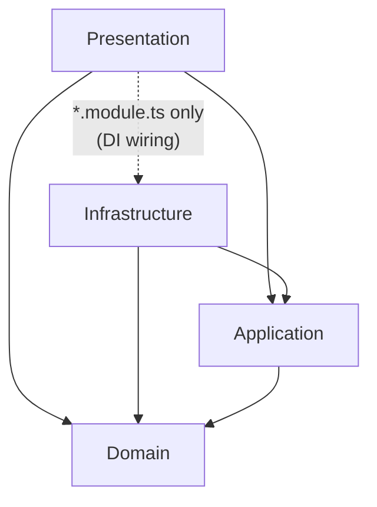

# NestJS Auth Template

A production-ready **authentication & authorization backend template** built with NestJS, following **Clean Architecture**, **Domain-Driven Design**, and **CQRS** — with the boundaries enforced automatically, not just by convention.

This is not a toy starter. It ships with everything a real backend needs on day one: JWT auth with refresh-token rotation, RBAC, file uploads with content validation, async email/notifications, Redis caching, full observability (errors, tracing, profiling, logs), Docker, CI, and a representative test suite — so new services can be spun up from it instead of rebuilt from scratch.

---

## Table of contents

- [Features](#features)
- [Tech stack](#tech-stack)
- [Architecture](#architecture)
- [Project structure](#project-structure)
- [Getting started](#getting-started)
- [Environment variables](#environment-variables)
- [Available scripts](#available-scripts)
- [API documentation & versioning](#api-documentation--versioning)
- [Endpoints overview](#endpoints-overview)
- [Testing](#testing)
- [Docker](#docker)
- [CI/CD](#cicd)
- [Observability](#observability)
- [Code quality & conventions](#code-quality--conventions)
- [Contributing](#contributing)
- [Reporting bugs](#reporting-bugs)
- [Suggesting features](#suggesting-features)
- [License](#license)
- [Author](#author)
- [Acknowledgments](#acknowledgments)
- [Support](#support)

---

## Features

**Auth & authorization**
- Register / login with JWT access tokens
- Refresh-token rotation via an httpOnly cookie (old token is revoked on every rotation), capped at 5 concurrent sessions per user (oldest is evicted, never rejected)
- Session management: list active sessions and revoke any of them individually, plus self-service account deletion
- Password reset and email verification flows (token-based, single-use), with expired/used tokens pruned automatically by a scheduled job
- Password complexity enforced at both the API boundary (Zod) and the domain layer (min 8 / max 128 chars, upper+lower+number)
- Per-account lockout (5 failed logins locks for 15 minutes) on top of per-IP rate limiting — survives a distributed attack spread across many IPs targeting one email; a successful password reset clears it immediately
- Role-based access control (roles ↔ permissions ↔ users)
- Rate limiting on sensitive endpoints (login, register, password reset)

**Platform capabilities**
- File uploads validated by real magic-byte sniffing (not the client-supplied `Content-Type`), with a curated MIME allowlist and path-traversal-safe storage keys; downloads/lists/deletes are scoped to the uploading user
- Streamed file downloads (no full-file buffering) and physical deletion on remove — not just a soft-deleted DB row
- Async email and notification delivery via BullMQ, with a dev-only Bull Board UI, retry/backoff, and failure reporting to Sentry once retries are exhausted
- Redis-backed cache-aside pattern on read-heavy queries, with explicit invalidation on writes
- Structured audit log for sensitive actions, recorded without adding latency to the response
- Timeout + circuit breaker resilience around queue jobs (`cockatiel`)

**Engineering quality**
- Clean Architecture layering (Domain / Application / Infrastructure / Presentation) enforced at build time by `dependency-cruiser` — a layering violation fails the build, it doesn't just get caught in review
- CQRS via `@nestjs/cqrs` for aggregates with real use cases
- Zod-validated request DTOs (`nestjs-zod`)
- Machine-readable error codes on every domain error response
- API versioning (`/v1`) from day one
- Unit tests (Jest) + e2e tests (Jest + Supertest) with a representative coverage strategy
- Full observability via Sentry: error tracking, tracing, profiling, and structured logs — one vendor, one SDK
- Multi-stage Docker build, `docker-compose` for local Postgres/Redis, GitHub Actions CI, Husky + Conventional Commits

---

## Tech stack

| Concern | Choice |
|---|---|
| Runtime | Node.js 22 |
| Framework | NestJS 11 |
| Language | TypeScript 5.9 |
| Database | PostgreSQL 17 + Prisma 7 (`@prisma/adapter-pg` driver adapter) |
| Validation | Zod 4 + `nestjs-zod` |
| Auth | Passport JWT + `bcrypt` |
| CQRS | `@nestjs/cqrs` |
| Queues | BullMQ + `@nestjs/bullmq` + Bull Board (dev-only admin UI) |
| Scheduling | `@nestjs/schedule` (expired-token cleanup jobs) |
| Cache | Redis via `@keyv/redis` + `@nestjs/cache-manager` |
| Resilience | `cockatiel` (timeout + circuit breaker) |
| File type validation | `file-type` (magic-byte sniffing) |
| Observability | `@sentry/nestjs` + `@sentry/profiling-node` (errors, tracing, profiling, logs) + `nestjs-pino` |
| API docs | `@nestjs/swagger` + Scalar (`/docs`) |
| Testing | Jest, Supertest, `@nestjs/testing`, `jest-mock-extended` |
| Architecture enforcement | `dependency-cruiser` |
| Containerization | Docker (multi-stage) + `docker-compose` |
| CI | GitHub Actions |
| Git hooks | Husky + commitlint (Conventional Commits) |

---

## Architecture

The codebase follows a strict 4-layer Clean Architecture. Dependencies only point inward — outer layers know about inner ones, never the reverse:



- **Domain** — entities and domain exceptions. Zero dependencies on anything else in the project.
- **Application** — use cases (CQRS commands/queries and their handlers), DTOs, and *ports* (interfaces) for anything only Infrastructure can provide (repositories, cache, queues, hashers).
- **Infrastructure** — concrete adapters implementing Application's ports: Prisma repositories, the Redis cache adapter, BullMQ queues, the resilience policy.
- **Presentation** — controllers, guards, decorators, request DTOs, and exception filters. Its `*.module.ts` files are the only place allowed to import Infrastructure directly — they're the composition root where interface → implementation bindings are registered.

These rules aren't just documented — they're enforced by `dependency-cruiser` on every build and in CI (`npm run depcruise`). A pull request that violates a layer boundary fails, full stop.

### Package-by-aggregate

Every layer is organized **by aggregate**, not by technical type — a `user/`, `role/` folder exists in all four layers, mirroring each other. Genuinely cross-cutting code within a layer lives in that layer's own `_shared/` folder (e.g. `application/_shared/cache.interface.ts`, `presentation/_shared/guards/`).

### Ports & adapters

Interfaces are introduced deliberately, not by default. A port exists only when Application/Domain needs something only Infrastructure can provide *and* it's plausible you'd swap the implementation as a business decision (e.g. `IUserRepository`, `ICache`, `ITokenHasher`). Stable, non-swappable primitives (`crypto.randomUUID()`, `Date`, `@nestjs/cqrs`'s `CommandBus`) are used directly — no port for the sake of a port.

Two ports ship with a second, ready-to-use adapter beyond the zero-config default. Swapping is a one-line `useClass` change in the composition-root module — nothing in the domain, application layer, or tests needs to know:

| Port | Default (zero-config) | Ready alternative | Swap in |
|---|---|---|---|
| `IFileStorage` | `LocalFileStorage` — local disk | `S3FileStorage` — needs `AWS_REGION` + `AWS_S3_BUCKET` | `file-asset.module.ts` |
| `IEmailSender` | `LogEmailSender` — logs, no real delivery | `ResendEmailSender` — needs `RESEND_API_KEY` + `EMAIL_FROM` | `email.module.ts` |
| `IPasswordBreachChecker` | `NoopPasswordBreachChecker` — never flags anything | `HibpPasswordBreachChecker` — checks HaveIBeenPwned via k-anonymity, no config needed | `auth.module.ts` + `users.module.ts` |

Both are genuinely optional: skip the env vars and the app runs exactly as before (local disk, logged "emails"). Set them and flip the one `useClass` line and nothing else changes.

---

## Project structure

```
src/
├── domain/                    # Entities + domain exceptions, no outward deps
│   ├── _shared/                 # DomainException base + shared exceptions
│   ├── user/
│   ├── role/  permission/
│   ├── refresh-token/  password-reset/  email-verification/
│   ├── file-asset/  notification/  audit-log/
│   └── ...
│
├── application/                # Use cases: CQRS commands/queries + ports
│   ├── _shared/                  # ICache, IEmailQueue, INotificationQueue, pagination
│   └── user/
│       ├── commands/
│       │   └── register-user/
│       │       ├── register-user.command.ts
│       │       ├── register-user.handler.ts
│       │       └── register-user.handler.spec.ts
│       └── queries/
│           └── get-user/
│
├── infrastructure/              # Adapters: Prisma repos, cache, queues, resilience
│   ├── _shared/                   # PrismaModule, AppCacheModule, env schema, queue policy
│   └── user/
│       └── user.repository.ts     # implements IUserRepository
│
└── presentation/                 # HTTP: controllers, guards, DTOs, filters
    ├── _shared/                    # guards, decorators, exception filters
    ├── user/
    │   ├── controllers/
    │   └── dtos/
    └── users.module.ts              # composition root: binds port -> Prisma impl
```

`*.module.ts` composition roots are flat directly under `presentation/` (`users.module.ts`, `roles.module.ts`, ...) - only `controllers/`/`dtos/` nest per-aggregate.

The pattern repeats for every aggregate: `audit-log`, `email-verification`, `file-asset`, `notification`, `password-reset`, `permission`, `refresh-token`, `role`, `user`, plus `health` (Infrastructure/Application/Presentation only — no domain entity of its own).

---

## Getting started

### Prerequisites

- Node.js 22+
- Docker (for local Postgres + 2 Redis instances) — or your own Postgres 17 + 2 Redis instances

### 1. Install dependencies

```bash
npm install
```

### 2. Configure environment variables

```bash
cp .env.example .env
```

Edit `.env` — at minimum set a strong `JWT_SECRET` (32+ characters). See [Environment variables](#environment-variables) below for the full list.

### 3. Start Postgres + Redis

```bash
docker-compose up -d
```

### 4. Apply the database schema

This project **never runs migrations automatically** — generate the SQL/migration and apply it yourself:

```bash
npx prisma generate
npx prisma migrate dev --name init
```

Optionally seed roles, permissions, and demo users:

```bash
npm run db:seed
```

### 5. Run the app

```bash
npm run start:dev
```

The API is now at `http://localhost:3000/v1`, interactive docs at `http://localhost:3000/docs`, and the health check at `http://localhost:3000/health`.

---

## Environment variables

| Variable | Required | Default | Description |
|---|---|---|---|
| `NODE_ENV` | No | `development` | `development` \| `production` \| `test` |
| `PORT` | No | `3000` | HTTP port |
| `DATABASE_URL` | **Yes** | — | PostgreSQL connection string |
| `DATABASE_POOL_SIZE` | No | `10` | Postgres connection pool size — tuning params in `DATABASE_URL` itself (`connection_limit`, etc.) are ignored by the driver adapter, this is the only way to change it |
| `JWT_SECRET` | **Yes** | — | Min. 32 chars, and rejected at boot if it's still the placeholder value from `.env.example` |
| `REDIS_URL` | **Yes** | — | Used by BullMQ and the rate-limiter's storage |
| `CACHE_REDIS_URL` | **Yes** | — | Used by the cache/rate-limit/lockout adapter — a Redis instance separate from `REDIS_URL`'s on purpose, so a queue backlog can't compete with the login-lockout counter for the same Redis's CPU/memory, and either side can independently move to Redis Cluster Mode later without the other |
| `CORS_ORIGIN` | No | `*` (fallback) | Comma-separated allowed origins — **required** if the frontend runs on a different origin, since `*` breaks the httpOnly refresh-token cookie |
| `TRUST_PROXY_HOPS` | No | — (untrusted) | Number of reverse-proxy hops in front of this process — set when deployed behind a load balancer/ingress, or the rate limiter's per-IP tracking collapses every client behind it into one bucket |
| `SENTRY_DSN` | No | — | Omit to run with Sentry fully disabled — no infra required |
| `AWS_REGION` | No | — | Only used if `IFileStorage` is swapped to `S3FileStorage` |
| `AWS_S3_BUCKET` | No | — | Only used if `IFileStorage` is swapped to `S3FileStorage` |
| `RESEND_API_KEY` | No | — | Only used if `IEmailSender` is swapped to `ResendEmailSender` |
| `EMAIL_FROM` | No | — | Only used if `IEmailSender` is swapped to `ResendEmailSender` — must be a Resend-verified sender address |

See [`.env.example`](.env.example) for the fully annotated version.

---

## Available scripts

| Script | Description |
|---|---|
| `npm run start:dev` | Run in watch mode |
| `npm run build` | Compile to `dist/` |
| `npm run start:prod` | Run the compiled build |
| `npm test` | Unit tests |
| `npm run test:watch` | Unit tests in watch mode |
| `npm run test:cov` | Unit tests with coverage |
| `npm run test:e2e` | End-to-end tests (needs Postgres reachable — Redis is mocked, see below) |
| `npm run lint` | ESLint with autofix |
| `npm run lint:check` | ESLint, no autofix — what CI runs |
| `npm run depcruise` | Verify Clean Architecture layer boundaries |
| `npm run db:seed` | Seed roles, permissions, and demo users |
| `npm run format` | Prettier write |

---

## API documentation & versioning

All routes are served under a global URI prefix, applied automatically without touching individual controllers:

```
http://localhost:3000/v1/...
```

`/health` is deliberately version-neutral (`VERSION_NEUTRAL`) — load balancers and uptime monitors shouldn't need to track API versions.

Interactive API documentation (Scalar, backed by the same OpenAPI document as Swagger) is served at:

```
http://localhost:3000/docs
```

---

## Endpoints overview

All paths below are relative to `/v1` (except `/health`).

| Resource | Method & path | Notes |
|---|---|---|
| **Auth** | `POST /auth/register` | Rate-limited; password must be 8-128 chars with upper+lower+number |
| | `POST /auth/login` | Rate-limited per IP + locked (`423`) after 5 failed attempts per account in 15 min; sets the refresh-token cookie |
| | `POST /auth/refresh` | Rotates the refresh token |
| | `POST /auth/logout` | Revokes the refresh token |
| | `GET /auth/sessions` | Lists the caller's active (non-revoked, non-expired) refresh tokens |
| | `DELETE /auth/sessions/:sessionId` | Revokes one specific session |
| | `POST /auth/request-password-reset` | Rate-limited; always 200, doesn't leak account existence |
| | `POST /auth/reset-password` | Same password policy as register; also clears any active lockout |
| | `POST /auth/verify-email` | |
| | `GET /auth/profile` | Requires JWT |
| **Users** | `GET /users` `GET /users/me` `GET /users/:id` | |
| | `PATCH /users/me` `PATCH /users/me/password` `PATCH /users/:id` | |
| | `DELETE /users/me` | Self-service account deletion |
| | `DELETE /users/:id` | Admin-initiated deletion |
| **Roles** | `POST /roles` `GET /roles` `DELETE /roles/:id` | |
| | `POST /roles/:id/permissions` (`permissionId` in body) `DELETE /roles/:id/permissions/:permissionId` | Attach/detach a permission |
| | `POST`/`DELETE /roles/:id/users/:userId` | Assign/unassign a user |
| **Permissions** | `POST /permissions` `GET /permissions` `DELETE /permissions/:id` | |
| **Files** | `POST /files` | Multipart upload, validated by magic bytes |
| | `GET /files` `GET /files/:id/download` `DELETE /files/:id` | Scoped to the requesting user's own files; download is streamed, delete removes the underlying bytes |
| **Notifications** | `GET /notifications/me` `PATCH /notifications/:id/read` | REST stays the source of truth |
| | WS `/notifications` namespace | Best-effort push to whoever's connected — see below |
| **Audit logs** | `GET /audit-logs` | |
| **Health** | `GET /health` | Readiness — unversioned; checks Postgres + both Redis connections (cache and queue, checked independently since they're separate clients); exempt from rate limiting |
| | `GET /health/live` | Liveness — no dependency checks, just confirms the process is responding |

Most routes beyond `/auth`'s public ones require a Bearer JWT (obtained from `/auth/login`). Users/Roles/Permissions endpoints are gated by fine-grained permission strings (`@RequirePermissions('users:write')` + `PermissionsGuard`, e.g. `users:read`, `users:write`, `roles:read`, `roles:write`, `permissions:read`, `permissions:write` — seeded in `prisma/seed.ts`), not just an `admin` role check — the seeded `support` role, for instance, has `users:read`/`users:write` without being `admin`. Audit Logs remain coarsely gated by role (`@Roles('admin')` + `RolesGuard`, also still available for simpler cases).

**WebSocket notifications**: connect to the `/notifications` namespace with the access token in the handshake (`io(url + '/notifications', { auth: { token } })`) — there's no `Authorization` header on a WS handshake, so `NotificationsGateway` verifies the token by hand instead of through `AuthGuard('jwt')`. A connected client joins a room scoped to its own user id and receives a `notification` event as soon as one is created; a client that's never connected, or drops mid-session, still sees everything through `GET /notifications/me` — the socket is a faster-delivery layer on top of that, never a replacement for it. `main.ts` wires Socket.io's Redis adapter (`@socket.io/redis-adapter`) for exactly this reason: without it, a notification created on one replica would never reach a socket connected to another.

---

## Testing

The test suite is split by what each tool is actually good at:

- **Unit tests** (co-located `*.spec.ts` files) instantiate the unit under test directly — command/query handlers via `jest-mock-extended` mocks (no DI container, no HTTP, no real infra), plus a few guards/strategies (`RolesGuard`, `PermissionsGuard`, `JwtStrategy`) and infrastructure adapters (`LocalFileStorage`'s path confinement, exercised against the real filesystem) where the logic is auth- or security-critical enough to be worth pinning down. Coverage is *representative*, not exhaustive: a handful of handlers per aggregate that carry real business logic, not all ~31.
- **E2E tests** (`test/*.e2e-spec.ts`) boot the real `AppModule` via `@nestjs/testing`, with every Redis-backed module (cache, email queue, notification queue) swapped for an in-memory fake via `overrideModule` (not `overrideProvider` — Nest eagerly instantiates every provider in a module, so only swapping the module itself avoids ever touching real Redis). **Postgres stays real**; no Redis instance needs to be reachable at all — `REDIS_URL`/`CACHE_REDIS_URL` only need to be syntactically valid values to satisfy env validation. Supertest fires real HTTP requests at the app; Jest's `expect()` asserts on the results.

```bash
npm test          # unit
npm run test:e2e  # e2e — needs Postgres reachable (docker-compose up -d covers it)
```

---

## Docker

**Local dependencies only** (Postgres + Redis, app runs on the host):

```bash
docker-compose up -d
```

**Full application image** (multi-stage: build → prune devDependencies → minimal Alpine runtime, non-root user, built-in `HEALTHCHECK` against `/health`):

```bash
docker build -t nest-auth-template .
docker run --env-file .env -p 3000:3000 --stop-timeout 20 nest-auth-template
```

If running alongside the `docker-compose` Postgres/Redis containers, point `DATABASE_URL`/`REDIS_URL`/`CACHE_REDIS_URL` at their service names (`postgres`, `redis-queue`, `redis-cache`) instead of `localhost`, and run the container on the same Docker network.

**On `--stop-timeout 20`**: on SIGTERM, BullMQ finishes whatever job is currently running before the process exits (see `app.enableShutdownHooks()` in `main.ts`) rather than killing it mid-flight. The queue-resilience policy caps a single job at 10s (`JOB_TIMEOUT_MS` in `queue-resilience.policy.ts`), so 20s leaves margin for that to finish before Docker sends `SIGKILL`. If deploying elsewhere, set the equivalent — `stop_grace_period` in a docker-compose service, or `terminationGracePeriodSeconds` in a Kubernetes pod spec.

### Scaling: HTTP and queue workers share one process

`main.ts` is the only entry point — it starts the HTTP server *and* registers the BullMQ processors (`EmailProcessor`, `NotificationProcessor`) in the same process, via the same `AppModule`. There's no separate worker entry point, build target, or env toggle to run one without the other.

This is safe (BullMQ is designed for multiple `Worker`s, on one process or many, pulling from the same queue concurrently — no duplicate/racing execution), but it means every replica scaled purely for HTTP throughput also runs its own copy of the queue processors, with no way to scale API capacity and worker capacity independently.

If that becomes a real need: add a second entry point (e.g. `worker.ts`) that creates the Nest application context with just `EmailModule`/`NotificationModule` and never calls `app.listen()`, give it its own `Dockerfile` `CMD`/build target, and drop those two modules from the HTTP app's imports. Not done here since a template has no real traffic pattern to design this split around — it's a deliberate simplification, not an oversight.

---

## CI/CD

Every pull request and push to `main` runs two independent GitHub Actions workflows:

**`ci.yml`** — against a real ephemeral Postgres service container:
1. Install dependencies
2. Generate the Prisma client
3. Lint (`lint:check`, no autofix)
4. Build
5. Sync the database schema (`prisma db push`)
6. Unit tests
7. E2E tests

**`codeql.yml`** — static security analysis of the codebase itself (not dependencies — see [Code quality & conventions](#code-quality--conventions)), also on a weekly schedule independent of any PR.

---

## Observability

All error tracking, tracing, profiling, and structured logging run through **Sentry alone** (`@sentry/nestjs` + `@sentry/profiling-node`) — deliberately not stacked with a separate OpenTelemetry/Prometheus/Grafana setup, since Sentry already covers all four signals on top of its own OTel instrumentation internally.

- Fully optional: omit `SENTRY_DSN` and `Sentry.init()` simply never runs — zero required infra.
- `sendDefaultPii` is deliberately left at its conservative default (never enabled) — this app has plaintext passwords in request bodies and a live refresh token in a cookie.
- `app.enableShutdownHooks()` ensures buffered Sentry events (and Prisma's own graceful disconnect) flush on `SIGTERM`/`SIGINT` instead of being dropped.

---

## Code quality & conventions

- **ESLint + Prettier**, `typescript-eslint` recommended-type-checked rules, on top of a strict-ish `tsconfig.json` (`noImplicitAny`, `strictNullChecks`, `strictBindCallApply`, `noFallthroughCasesInSwitch` all on).
- **Husky + commitlint**: commits must follow [Conventional Commits](https://www.conventionalcommits.org/); enforced by a Git hook, not just documentation.
- **dependency-cruiser**: the Clean Architecture layer rules described above, enforced on every build.
- **Machine-readable error codes**: every domain exception maps to a stable `{ statusCode, code, message, requestId }` shape via `DomainExceptionFilter`, so frontends can branch on `code` instead of parsing `message` strings, and correlate a failed request against logs/Sentry via `requestId` (also echoed as the `X-Request-Id` response header).
- **Automated dependency & security scanning**: Dependabot (`.github/dependabot.yml`) opens PRs for outdated/vulnerable npm, Docker, and GitHub Actions dependencies; CodeQL (`.github/workflows/codeql.yml`) runs static security analysis on every PR and weekly on `main`.
- **Transactional multi-step writes**: `RegisterUserHandler`, `VerifyEmailHandler`, `ResetPasswordHandler`, and `DeleteUserHandler` wrap their related Postgres writes (user + token/session state) in a single transaction via `ITransactionRunner`, so a failure partway through can't leave them out of sync. The login-lockout failure counter uses an atomic Redis `INCR` for the same reason — a plain get-then-set couplet would lose increments under concurrent failed attempts.
- **Repo governance**: `.nvmrc` + `engines` pin the Node version; `CODEOWNERS`, issue templates, and a PR template are ready for when this moves to a real, possibly multi-contributor repository.

---

## Contributing

Contributions are very welcome! 🎉

1. Fork the project
2. Create a feature branch (`git checkout -b feature/MyFeature`)
3. Commit your changes (`git commit -m 'feat: add MyFeature'`)
4. Push to the branch (`git push origin feature/MyFeature`)
5. Open a Pull Request

### Commit convention

This project uses [Conventional Commits](https://www.conventionalcommits.org/), enforced by Husky + commitlint on every commit — not just documented:

```
feat:     new feature
fix:      bug fix
docs:     documentation changes
style:    code formatting (no logic change)
refactor: code refactor
test:     add or fix tests
chore:    maintenance tasks
perf:     performance improvement
ci:       CI/CD changes
build:    build or dependency changes
```

### Before opening a PR

- [ ] All tests pass (`npm test` and `npm run test:e2e`)
- [ ] Lint is clean (`npm run lint:check`)
- [ ] Format is clean (`npm run format:check`)
- [ ] Architecture boundaries hold (`npm run depcruise`)
- [ ] Build succeeds (`npm run build`)
- [ ] Commits follow Conventional Commits

### Cutting a release

```bash
npm run release
```

[commit-and-tag-version](https://github.com/absolute-version/commit-and-tag-version) reads the Conventional Commits since the last tag, bumps `package.json`'s version accordingly (`fix:` → patch, `feat:` → minor, `BREAKING CHANGE:` → major), updates [CHANGELOG.md](CHANGELOG.md), and creates a commit + git tag — all locally, nothing is published anywhere automatically. Push the resulting commit and tag (`git push --follow-tags`) when ready.

---

## Reporting bugs

Open an issue including:

- A clear description of the bug
- Steps to reproduce
- Expected vs. actual behavior
- Screenshots, if applicable
- Environment (OS, Node version, etc.)

## Suggesting features

Open an issue including:

- A description of the feature
- Why it's useful
- Usage examples
- Mockups, if applicable

---

## License

This project is licensed under the [MIT License](LICENSE).

## Author

**Hugo Cicillini**

- 📧 Email: [hugo.cicillini@hotmail.com](mailto:hugo.cicillini@hotmail.com)
- 💼 GitHub: [@hugocicillini](https://github.com/hugocicillini)
- 🌐 LinkedIn: [Hugo Cicillini](https://linkedin.com/in/hugocicillini)

## Acknowledgments

Built on top of the excellent work of the [NestJS](https://nestjs.com/), [Prisma](https://www.prisma.io/), [BullMQ](https://bullmq.io/), and [Sentry](https://sentry.io/) teams, and the wider open-source community whose libraries power this template.

## Support

Found a bug or have a question?

- 🐛 Bugs: open an issue in this repository's tracker
- 💬 Questions: use this repository's Discussions tab
- 📧 Email: [hugo.cicillini@hotmail.com](mailto:hugo.cicillini@hotmail.com)

> Repository not published yet — once it is, link the Issues/Discussions URLs above directly.

If this project helped you, consider giving it a ⭐ on GitHub!

[⬆ Back to top](#nestjs-auth-template)
