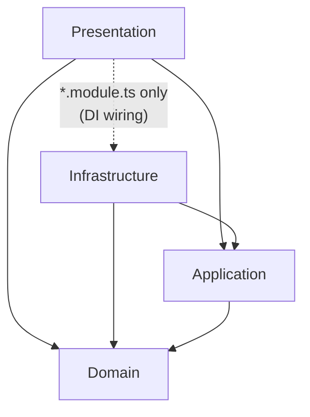

# Template de autenticação NestJS

[English](README.md) | [Português (Brasil)](README.pt-BR.md)

Template de backend de **autenticação e autorização pronto para produção**,
construído com NestJS e seguindo **Clean Architecture**, **Domain-Driven
Design** e **CQRS** — com as fronteiras verificadas automaticamente, não apenas
por convenção.

Este não é um starter kit. Ele já vem com tudo o que um backend real
precisa desde o primeiro dia: autenticação JWT com rotação de refresh token,
RBAC, upload de arquivos com validação de conteúdo, envio assíncrono de
e-mails/notificações, cache Redis, observabilidade completa (erros, tracing,
profiling e logs), Docker, CI e uma suíte de testes representativa — para que
novos serviços possam ser criados a partir dele em vez de reconstruídos do
zero.


---

## Índice

- [Recursos](#recursos)
- [Tecnologias](#tecnologias)
- [Arquitetura](#arquitetura)
- [Estrutura do projeto](#estrutura-do-projeto)
- [Como começar](#como-começar)
- [Variáveis de ambiente](#variáveis-de-ambiente)
- [Scripts disponíveis](#scripts-disponíveis)
- [Documentação e versionamento da API](#documentação-e-versionamento-da-api)
- [Visão geral dos endpoints](#visão-geral-dos-endpoints)
- [Testes](#testes)
- [Docker](#docker)
- [CI/CD](#cicd)
- [Observabilidade](#observabilidade)
- [Qualidade e convenções](#qualidade-e-convenções)
- [Contribuição](#contribuição)
- [Reportar bugs](#reportar-bugs)
- [Sugerir funcionalidades](#sugerir-funcionalidades)
- [Licença](#licença)
- [Autor](#autor)
- [Agradecimentos](#agradecimentos)
- [Suporte](#suporte)


---

## Recursos

**Autenticação e autorização**
- Registro/login com access tokens JWT
- Rotação do refresh token por cookie httpOnly (o token antigo é revogado a
  cada rotação), limitada a 5 sessões simultâneas por usuário (a mais antiga é
  removida, nunca rejeitada)
- Gerenciamento de sessões: lista sessões ativas e revoga qualquer uma
  individualmente, além da exclusão da própria conta
- Fluxos de redefinição de senha e verificação de e-mail (baseados em token e
  de uso único), com tokens expirados/usados removidos automaticamente por um
  job agendado
- Complexidade de senha aplicada tanto na borda da API (Zod) quanto na camada
  de domínio (mín. 8 / máx. 128 caracteres, maiúscula + minúscula + número)
- Bloqueio por conta (5 logins falhos bloqueiam por 15 minutos), além do rate
  limiting por IP — resiste a um ataque distribuído por vários IPs contra um
  e-mail; uma redefinição de senha bem-sucedida o remove imediatamente
- Controle de acesso baseado em roles (roles ↔ permissões ↔ usuários)
- Rate limiting em endpoints sensíveis (login, registro, redefinição de senha)

**Capacidades da plataforma**
- Uploads de arquivos validados por detecção real de magic bytes (não pelo
  `Content-Type` informado pelo cliente), com allowlist MIME selecionada e
  chaves de armazenamento seguras contra path traversal; downloads, listagens e
  exclusões são limitados ao usuário que fez o upload
- Downloads de arquivos em streaming (sem bufferizar o arquivo inteiro) e
  exclusão física ao remover — não apenas uma linha de banco marcada como
  excluída
- Entrega assíncrona de e-mails e notificações via BullMQ, com Bull Board
  apenas em development, retry/backoff e relatório de falhas ao Sentry após
  esgotar as tentativas
- Padrão cache-aside baseado em Redis para consultas intensivas de leitura, com
  invalidação explícita nas escritas
- Audit log estruturado para ações sensíveis, registrado sem adicionar
  latência à resposta
- Resiliência com timeout + circuit breaker em jobs de fila (`cockatiel`)

**Qualidade de engenharia**
- Camadas de Clean Architecture (Domain / Application / Infrastructure /
  Presentation) aplicadas no build pelo `dependency-cruiser` — uma violação de
  camada falha o build, em vez de apenas ser detectada na revisão
- CQRS via `@nestjs/cqrs` para agregados com casos de uso reais
- DTOs de requisição validados com Zod (`nestjs-zod`)
- Códigos de erro legíveis por máquina em toda resposta de erro de domínio
- Versionamento de API (`/v1`) desde o primeiro dia
- Testes unitários (Jest) + testes E2E (Jest + Supertest) com estratégia de
  cobertura representativa
- Observabilidade completa via Sentry: rastreamento de erros, tracing,
  profiling e logs estruturados — um fornecedor, um SDK
- Build Docker multi-stage, `docker-compose` para Postgres/Redis local, CI com
  GitHub Actions, Husky + Conventional Commits


---

## Tecnologias

| Preocupação | Escolha |
|---|---|
| Runtime | Node.js 22 |
| Framework | NestJS 11 |
| Linguagem | TypeScript 5.9 |
| Banco de dados | PostgreSQL 17 + Prisma 7 (`@prisma/adapter-pg` como driver adapter) |
| Validação | Zod 4 + `nestjs-zod` |
| Autenticação | Passport JWT + `bcrypt` |
| CQRS | `@nestjs/cqrs` |
| Filas | BullMQ + `@nestjs/bullmq` + Bull Board (UI administrativa apenas em development) |
| Agendamento | `@nestjs/schedule` (jobs de limpeza de tokens expirados) |
| Cache | Redis via `@keyv/redis` + `@nestjs/cache-manager` |
| Resiliência | `cockatiel` (timeout + circuit breaker) |
| Validação de tipo de arquivo | `file-type` (detecção por magic bytes) |
| Observabilidade | `@sentry/nestjs` + `@sentry/profiling-node` (erros, tracing, profiling e logs) + `nestjs-pino` |
| Documentação da API | `@nestjs/swagger` + Scalar (`/docs`) |
| Testes | Jest, Supertest, `@nestjs/testing`, `jest-mock-extended` |
| Verificação arquitetural | `dependency-cruiser` |
| Conteinerização | Docker (multi-stage) + `docker-compose` |
| CI | GitHub Actions |
| Git hooks | Husky + commitlint (Conventional Commits) |


---

## Arquitetura

A base de código segue uma Clean Architecture rigorosa de 4 camadas. As dependências apontam apenas para dentro — as camadas externas conhecem as internas, nunca o contrário:



- **Domain** — entidades e exceções de domínio. Zero dependências de qualquer
  outra parte do projeto.
- **Application** — casos de uso (commands/queries CQRS e seus handlers), DTOs
  e *ports* (interfaces) para tudo que somente a Infrastructure pode fornecer
  (repositórios, cache, filas, hashers).
- **Infrastructure** — adapters concretos que implementam os ports da
  Application: repositórios Prisma, adapter de cache Redis, filas BullMQ e
  política de resiliência.
- **Presentation** — controllers, guards, decorators, DTOs de requisição e
  filtros de exceção. Seus arquivos `*.module.ts` são o único lugar autorizado
  a importar Infrastructure diretamente — são o composition root onde os
  vínculos interface → implementação são registrados.

Essas regras não são apenas documentadas — são aplicadas pelo
`dependency-cruiser` em todo build e no CI (`npm run depcruise`). Um pull
request que viola uma fronteira de camada falha, sem exceção.

### Organização por agregado

Cada camada é organizada **por agregado**, não por tipo técnico — uma pasta
`user/` e `role/` existe nas quatro camadas, espelhando-se entre elas. Código
genuinamente transversal dentro de uma camada fica na pasta `_shared` daquela
própria camada (por exemplo, `application/_shared/cache.interface.ts` e
`presentation/_shared/guards/`).

### Ports and adapters

Interfaces são introduzidas deliberadamente, não por padrão. Um port existe
somente quando Application/Domain precisa de algo que apenas Infrastructure
pode fornecer e é plausível trocar a implementação como decisão de negócio
(por exemplo, `IUserRepository`, `ICache`, `ITokenHasher`). Primitivas estáveis
e não substituíveis (`crypto.randomUUID()`, `Date`, `@nestjs/cqrs`'s
`CommandBus`) são usadas diretamente — não há port apenas por haver um port.

Dois ports vêm com um segundo adapter pronto para uso além do padrão sem
configuração. A troca é uma alteração de uma linha em `useClass` no módulo
composition-root — nada no domínio, na camada de aplicação ou nos testes
precisa conhecer:

| Port | Padrão (sem configuração) | Alternativa pronta | Trocar em |
|---|---|---|---|
| `IFileStorage` | `LocalFileStorage` — disco local | `S3FileStorage` — requer `AWS_REGION` + `AWS_S3_BUCKET` | `file-asset.module.ts` |
| `IEmailSender` | `LogEmailSender` — registra logs, sem entrega real | `ResendEmailSender` — requer `RESEND_API_KEY` + `EMAIL_FROM` | `email.module.ts` |
| `IPasswordBreachChecker` | `NoopPasswordBreachChecker` — nunca sinaliza nada | `HibpPasswordBreachChecker` — consulta HaveIBeenPwned via k-anonymity, sem configuração | `auth.module.ts` + `users.module.ts` |

Ambos são genuinamente opcionais: ignore as variáveis de ambiente e a
aplicação executará exatamente como antes (disco local, “e-mails” registrados
em log). Defina-as, altere a única linha `useClass` e nada mais muda.


---

## Estrutura do projeto

```text
src/
├── domain/                    # Entidades + exceções de domínio, sem dependências externas
│   ├── _shared/               # Base DomainException + exceções compartilhadas
│   ├── user/
│   ├── role/  permission/
│   ├── refresh-token/  password-reset/  email-verification/
│   ├── file-asset/  notification/  audit-log/
│   └── ...
│
├── application/               # Casos de uso: commands/queries CQRS + ports
│   ├── _shared/               # ICache, IEmailQueue, INotificationQueue, paginação
│   └── user/
│       ├── commands/
│       │   └── register-user/
│       │       ├── register-user.command.ts
│       │       ├── register-user.handler.ts
│       │       └── register-user.handler.spec.ts
│       └── queries/
│           └── get-user/
│
├── infrastructure/            # Adapters: repositórios Prisma, cache, filas, resiliência
│   ├── _shared/               # PrismaModule, AppCacheModule, schema de ambiente, política de filas
│   └── user/
│       └── user.repository.ts # implementa IUserRepository
│
└── presentation/              # HTTP: controllers, guards, DTOs, filtros
    ├── _shared/               # guards, decorators, filtros de exceção
    ├── user/
    │   ├── controllers/
    │   └── dtos/
    └── users.module.ts        # composition root: vincula port -> implementação Prisma
```

Os `*.module.ts` de composition root ficam diretamente em `presentation/`
(`users.module.ts`, `roles.module.ts`, ...); somente `controllers/` e `dtos/`
ficam aninhados por agregado.

O padrão se repete para todos os agregados: `audit-log`,
`email-verification`, `file-asset`, `notification`, `password-reset`,
`permission`, `refresh-token`, `role`, `user` e também `health`
(somente Infrastructure/Application/Presentation — sem uma entidade própria
de domínio).


---

## Como começar

### Pré-requisitos

- Node.js 22 ou superior.
- Docker (para PostgreSQL e duas instâncias Redis), ou PostgreSQL 17 e duas
  instâncias Redis próprias.

### 1. Instalar dependências

```bash
npm install
```

### 2. Configurar variáveis de ambiente

```bash
cp .env.example .env
```

Edite o `.env` e defina um `JWT_SECRET` forte com pelo menos 32 caracteres.
Consulte [Variáveis de ambiente](#variáveis-de-ambiente) para a lista completa.

### 3. Iniciar Postgres + Redis

```bash
docker-compose up -d
```

### 4. Aplicar o schema do banco

O projeto **nunca executa migrations automaticamente**. Gere e aplique a
migration manualmente:

```bash
npx prisma generate
npx prisma migrate dev --name init
```

Opcionalmente, popule roles, permissões e usuários de demonstração:

```bash
npm run db:seed
```

### 5. Executar a aplicação

```bash
npm run start:dev
```

A API estará em `http://localhost:3000/v1`, a documentação interativa em
`http://localhost:3000/docs` e o health check em
`http://localhost:3000/health`.


---

## Variáveis de ambiente

| Variável | Obrigatória | Padrão | Descrição |
|---|---|---|---|
| `NODE_ENV` | Não | `development` | `development` \| `production` \| `test` |
| `PORT` | Não | `3000` | Porta HTTP |
| `DATABASE_URL` | **Sim** | — | String de conexão PostgreSQL |
| `DATABASE_POOL_SIZE` | Não | `10` | Tamanho do pool de conexões PostgreSQL — parâmetros de ajuste na própria `DATABASE_URL` (`connection_limit`, etc.) são ignorados pelo driver adapter; esta é a única forma de alterá-lo |
| `JWT_SECRET` | **Sim** | — | Mínimo de 32 caracteres; o placeholder do `.env.example` é rejeitado no boot |
| `REDIS_URL` | **Sim** | — | Usado pelo BullMQ e pelo armazenamento do rate limiter |
| `CACHE_REDIS_URL` | **Sim** | — | Usado pelo adapter de cache/rate-limit/lockout — uma instância Redis propositalmente separada da `REDIS_URL`, para que uma fila acumulada não concorra pela CPU/memória do contador de lockout e ambos possam migrar independentemente para Redis Cluster Mode |
| `CORS_ORIGIN` | Não | `*` (fallback) | Origens permitidas separadas por vírgula — **obrigatório** se o frontend executar em outra origem, pois `*` quebra o cookie de refresh token httpOnly |
| `TRUST_PROXY_HOPS` | Não | — (não confiável) | Número de saltos de proxy reverso à frente deste processo — defina atrás de load balancer/ingress, ou o rate limiter por IP colocará todos os clientes em um único bucket |
| `SENTRY_DSN` | Não | — | Omita para executar com o Sentry totalmente desativado — nenhuma infraestrutura necessária |
| `AWS_REGION` | Não | — | Usada somente ao trocar `IFileStorage` por `S3FileStorage` |
| `AWS_S3_BUCKET` | Não | — | Usada somente ao trocar `IFileStorage` por `S3FileStorage` |
| `RESEND_API_KEY` | Não | — | Usada somente ao trocar `IEmailSender` por `ResendEmailSender` |
| `EMAIL_FROM` | Não | — | Usada somente ao trocar `IEmailSender` por `ResendEmailSender` — deve ser um endereço de remetente verificado no Resend |

Consulte o [.env.example](.env.example) para a versão comentada.


---

## Scripts disponíveis

| Comando | Descrição |
|---|---|
| `npm run start:dev` | Executa em modo watch |
| `npm run build` | Compila a aplicação |
| `npm run start:prod` | Executa o build compilado |
| `npm test` | Testes unitários |
| `npm run test:watch` | Testes unitários em modo watch |
| `npm run test:cov` | Testes unitários com cobertura |
| `npm run test:e2e` | Testes E2E; requer Postgres, enquanto módulos Redis usam fakes e o throttler usa memória em `NODE_ENV=test` |
| `npm run lint` | ESLint com autofix |
| `npm run lint:check` | ESLint sem autofix |
| `npm run depcruise` | Verifica fronteiras arquiteturais |
| `npm run db:seed` | Popula roles, permissões e usuários demo |
| `npm run format` | Formata os arquivos |


---

## Documentação e versionamento da API

Todas as rotas são servidas sob o prefixo URI global:

```text
http://localhost:3000/v1/...
```

`/health` é deliberadamente neutro em relação à versão (`VERSION_NEUTRAL`),
para que load balancers e monitores não precisem acompanhar versões da API.

A documentação interativa do Scalar, baseada no mesmo documento OpenAPI do
Swagger, está disponível em:

```text
http://localhost:3000/docs
```


---

## Visão geral dos endpoints

Todas as rotas abaixo são relativas a `/v1`, exceto `/health`:

| Recurso | Método e caminho | Observações |
|---|---|---|
| **Auth** | `POST /auth/register` | Rate-limited; senha deve ter 8-128 caracteres com maiúscula + minúscula + número |
| | `POST /auth/login` | Rate-limited por IP + bloqueado (`423`) após 5 falhas por conta em 15 min; define o cookie de refresh token |
| | `POST /auth/refresh` | Rotaciona o refresh token |
| | `POST /auth/logout` | Revoga o refresh token |
| | `GET /auth/sessions` | Lista os refresh tokens ativos (não revogados e não expirados) do usuário |
| | `DELETE /auth/sessions/:sessionId` | Revoga uma sessão específica |
| | `POST /auth/request-password-reset` | Rate-limited; sempre retorna 200 e não revela se a conta existe |
| | `POST /auth/reset-password` | Mesma política de senha do registro; também remove qualquer bloqueio ativo |
| | `POST /auth/verify-email` | |
| | `GET /auth/profile` | Requer JWT |
| **Usuários** | `GET /users` `GET /users/me` `GET /users/:id` | |
| | `PATCH /users/me` `PATCH /users/me/password` `PATCH /users/:id` | |
| | `DELETE /users/me` | Exclusão da própria conta |
| | `DELETE /users/:id` | Exclusão iniciada por administrador |
| **Roles** | `POST /roles` `GET /roles` `DELETE /roles/:id` | |
| | `POST /roles/:id/permissions` (`permissionId` no body) `DELETE /roles/:id/permissions/:permissionId` | Adiciona/remove uma permissão |
| | `POST`/`DELETE /roles/:id/users/:userId` | Atribui/remove um usuário |
| **Permissões** | `POST /permissions` `GET /permissions` `DELETE /permissions/:id` | |
| **Arquivos** | `POST /files` | Upload multipart validado por magic bytes |
| | `GET /files` `GET /files/:id/download` `DELETE /files/:id` | Limitado aos arquivos do usuário solicitante; download em streaming e delete remove os bytes subjacentes |
| **Notificações** | `GET /notifications/me` `PATCH /notifications/:id/read` | REST continua sendo a fonte de verdade |
| | WS namespace `/notifications` | Push best-effort para quem estiver conectado — veja abaixo |
| **Logs de auditoria** | `GET /audit-logs` | |
| **Health** | `GET /health` | Readiness — sem versão; verifica PostgreSQL + as duas conexões Redis independentemente; isento de rate limiting |
| | `GET /health/live` | Liveness — sem verificações de dependências, apenas confirma que o processo responde |

`/health` verifica PostgreSQL e os dois Redis separadamente. `/health/live`
somente confirma que o processo está respondendo.

Quase todas as rotas além das públicas de `/auth` exigem um access token
(obtido em `/auth/login`). Os endpoints de Usuários/Roles/Permissões são
protegidos por strings de permissão granulares
(`@RequirePermissions('users:write')` + `PermissionsGuard`, por exemplo
`users:read`, `users:write`, `roles:read`, `roles:write`, `permissions:read`,
`permissions:write`, sem depender apenas de uma role `admin`). A role
`support`, por exemplo, possui `users:read`/`users:write` sem ser `admin`.
Os Logs de auditoria continuam protegidos de forma ampla por role
(`@Roles('admin')` + `RolesGuard`).

**Notificações WebSocket**: conecte-se ao namespace `/notifications` com o
access token no handshake
(`io(url + '/notifications', { auth: { token } })`). Como não existe header
`Authorization` em um handshake WS, `NotificationsGateway` verifica o token
manualmente em vez de usar `AuthGuard('jwt')`. O cliente conectado entra em uma
sala limitada ao seu próprio ID e recebe um evento `notification` assim que
uma notificação é criada; clientes que nunca se conectaram ou que caíram no
meio da sessão continuam vendo tudo por `GET /notifications/me`. O socket é
uma camada de entrega mais rápida, nunca um substituto. O `main.ts` configura
o adapter Redis do Socket.io (`@socket.io/redis-adapter`) para que uma
notificação criada em uma réplica chegue a um socket conectado em outra.


---

## Testes

A suíte de testes é dividida de acordo com aquilo em que cada ferramenta é
realmente boa:

- **Testes unitários** (arquivos `*.spec.ts` junto ao código) instanciam
  diretamente a unidade testada — handlers de commands/queries usam mocks
  `jest-mock-extended` (sem container DI, HTTP ou infraestrutura real), além de
  alguns guards/strategies (`RolesGuard`, `PermissionsGuard`, `JwtStrategy`) e
  adapters de infraestrutura (o confinamento de caminhos do
  `LocalFileStorage`, exercitado contra o sistema de arquivos real) quando a
  lógica é crítica para autenticação ou segurança. A cobertura é
  *representativa*, não exaustiva: alguns handlers por agregado que carregam
   lógica de negócio real, não todos os ~31.
- **Testes E2E** (`test/*.e2e-spec.ts`) inicializam o `AppModule` real via
  `@nestjs/testing`, com todos os módulos baseados em Redis (cache, fila de
  e-mail e fila de notificações) substituídos por um fake em memória via
  `overrideModule` (não `overrideProvider` — o Nest instancia imediatamente
  todos os providers de um módulo, então somente trocar o módulo evita tocar
  no Redis real). Em `NODE_ENV=test`, o throttler também usa o armazenamento
  em memória do Nest. **O PostgreSQL permanece real**; o Redis fica disponível
  no CI para os módulos da aplicação que ainda precisam dele, enquanto os fakes
  E2E mantêm os testes determinísticos. O Supertest faz requisições HTTP reais
  contra a aplicação; o `expect()` do Jest verifica os resultados.

```bash
npm test          # unitários
npm run test:e2e  # e2e — requer Postgres acessível (docker-compose up -d cobre isso)
```


---

## Docker

**Somente dependências locais** (Postgres + Redis; a aplicação executa no host):

```bash
docker-compose up -d
```

**Imagem completa da aplicação** (multi-stage: build → remoção de
devDependencies → runtime Alpine mínimo, usuário não-root, `HEALTHCHECK`
integrado contra `/health`):

```bash
docker build -t nest-auth-template .
docker run --env-file .env -p 3000:3000 --stop-timeout 20 nest-auth-template
```

Se executar junto aos containers Postgres/Redis do `docker-compose`, aponte
`DATABASE_URL`/`REDIS_URL`/`CACHE_REDIS_URL` para os nomes dos serviços
(`postgres`, `redis-queue`, `redis-cache`) em vez de `localhost`, e execute o
container na mesma rede Docker.

**Sobre `--stop-timeout 20`**: no SIGTERM, o BullMQ termina o job em execução
antes de o processo sair (consulte `app.enableShutdownHooks()` em `main.ts`),
em vez de interrompê-lo no meio. A política de resiliência limita cada job a
10s (`JOB_TIMEOUT_MS` em `queue-resilience.policy.ts`), então 20s deixam margem
antes de o Docker enviar `SIGKILL`. Em outros ambientes, configure o equivalente
— `stop_grace_period` em um serviço docker-compose ou
`terminationGracePeriodSeconds` em um pod Kubernetes.

### Escalabilidade: API e workers compartilham um processo

`main.ts` é o único entry point — inicia o servidor HTTP *e* registra os
processors BullMQ (`EmailProcessor`, `NotificationProcessor`) no mesmo
processo, por meio do mesmo `AppModule`. Não existe entry point, build target ou
toggle de ambiente separado para executar um sem o outro.

Isso é seguro (o BullMQ foi projetado para múltiplos `Worker`s, em um ou vários
processos, consumindo a mesma fila concorrentemente — sem execução duplicada ou
disputa), mas significa que cada réplica escalada apenas para throughput HTTP
também executa sua própria cópia dos processors, sem maneira de escalar
independentemente a capacidade da API e dos workers.

Se isso se tornar necessário: adicione um segundo entry point (por exemplo,
`worker.ts`) que crie o contexto da aplicação Nest apenas com
`EmailModule`/`NotificationModule` e nunca chame `app.listen()`, dê a ele seu
próprio `CMD`/build target no `Dockerfile` e remova esses dois módulos dos
imports da aplicação HTTP. Isso não foi feito porque um template não tem um
padrão real de tráfego para orientar essa divisão — é uma simplificação
deliberada, não uma omissão.


---

## CI/CD

Todo pull request direcionado a `develop` ou `main`, e todo push para qualquer
uma dessas branches, executa o workflow de CI. O CodeQL executa em pull
requests direcionados a `main`, pushes para `main` e semanalmente:

**`ci.yml`** — contra um container de serviço Postgres efêmero real:
1. Instala dependências
2. Gera o Prisma Client
3. Executa lint (`lint:check`, sem autofix)
4. Verifica a formatação (`format:check`)
5. Compila
6. Aplica migrations commitadas (`prisma migrate deploy`)
7. Testes unitários
8. Testes E2E
9. Build da imagem Docker

**`codeql.yml`** — análise estática de segurança do próprio código (não das
dependências — veja [Qualidade e convenções](#qualidade-e-convenções)) em
`main`, também em uma agenda semanal independente de qualquer PR.


---

## Observabilidade

Todo rastreamento de erros, tracing, profiling e logs estruturados passa
**somente pelo Sentry** (`@sentry/nestjs` + `@sentry/profiling-node`) —
deliberadamente sem uma configuração separada de
OpenTelemetry/Prometheus/Grafana, pois o Sentry já cobre os quatro sinais sobre
sua própria instrumentação OTel interna.

- Totalmente opcional: omita `SENTRY_DSN` e `Sentry.init()` simplesmente não
  será executado — nenhuma infraestrutura obrigatória.
- `sendDefaultPii` é deliberadamente mantido no padrão conservador (nunca
  habilitado) — a aplicação possui senhas em texto puro no corpo das requisições
  e um refresh token ativo em um cookie.
- `app.enableShutdownHooks()` garante que eventos do Sentry em buffer (e a
  desconexão graciosa do Prisma) sejam enviados em `SIGTERM`/`SIGINT`, em vez
  de descartados.


---

## Qualidade e convenções

- **ESLint + Prettier**, regras recomendadas com verificação de tipos do
  `typescript-eslint`, sobre um `tsconfig.json` estrito (`noImplicitAny`,
  `strictNullChecks`, `strictBindCallApply`, `noFallthroughCasesInSwitch`
  habilitados).
- **Husky + commitlint**: commits devem seguir
  [Conventional Commits](https://www.conventionalcommits.org/); aplicado por
  Git hook, não apenas documentado.
- **dependency-cruiser**: regras de camadas da Clean Architecture descritas
  acima, aplicadas em todo build.
- **Códigos de erro legíveis por máquina**: toda exceção de domínio mapeia para
  um formato estável `{ statusCode, code, message, requestId }` por meio do
  `DomainExceptionFilter`, permitindo que frontends usem `code` em vez de
  interpretar mensagens e correlacionem requisições com logs/Sentry por
  `requestId` (também devolvido no header `X-Request-Id`).
- **Verificação automatizada de dependências e segurança**: o Dependabot
  (`.github/dependabot.yml`) abre PRs para dependências npm, Docker e GitHub
  Actions desatualizadas/vulneráveis; o CodeQL
  (`.github/workflows/codeql.yml`) executa análise estática em todo PR e
  semanalmente em `main`.
- **Escritas transacionais em múltiplas etapas**: `RegisterUserHandler`,
  `VerifyEmailHandler`, `ResetPasswordHandler` e `DeleteUserHandler` envolvem
  suas escritas relacionadas no Postgres (usuário + estado de
  token/sessão) em uma única transação via `ITransactionRunner`, evitando
  inconsistências em falhas parciais. O contador de falhas do lockout usa
  `INCR` atômico no Redis pelo mesmo motivo — um par get-then-set perderia
  incrementos em tentativas concorrentes.
- **Governança do repositório**: `.nvmrc` + `engines` fixam a versão do Node;
  `CODEOWNERS`, templates de issues e template de PR estão prontos para quando
  este projeto se tornar um repositório real, possivelmente com vários
  colaboradores.


---

## Contribuição

Contribuições são muito bem-vindas! 🎉

1. Faça um fork do projeto
2. Crie uma branch de feature (`git checkout -b feature/MyFeature`)
3. Faça commit das alterações (`git commit -m 'feat: add MyFeature'`)
4. Envie a branch (`git push origin feature/MyFeature`)
5. Abra um Pull Request

### Convenção de commits

Este projeto usa [Conventional Commits](https://www.conventionalcommits.org/),
aplicado pelo Husky + commitlint em todo commit — não apenas documentado:

```text
feat:     nova funcionalidade
fix:      correção de bug
docs:     alterações na documentação
style:    formatação de código (sem alteração de lógica)
refactor: refatoração de código
test:     adicionar ou corrigir testes
chore:    tarefas de manutenção
perf:     melhoria de performance
ci:       alterações de CI/CD
build:    alterações de build ou dependências
```

### Antes de abrir um PR

- [ ] Todos os testes passam (`npm test` e `npm run test:e2e`)
- [ ] O lint está limpo (`npm run lint:check`)
- [ ] A formatação está correta (`npm run format:check`)
- [ ] As fronteiras arquiteturais estão válidas (`npm run depcruise`)
- [ ] O build passa (`npm run build`)
- [ ] Os commits seguem Conventional Commits

### Criar uma release

```bash
npm run release
```

O `commit-and-tag-version` lê os Conventional Commits desde a última tag,
atualiza a versão do `package.json`, altera o [CHANGELOG.md](CHANGELOG.md) e
cria commit e tag localmente. Nada é publicado automaticamente; quando estiver
pronto, use `git push --follow-tags`.


---

## Reportar bugs

Abra uma issue com:

- descrição clara;
- passos para reproduzir;
- comportamento esperado e atual;
- screenshots, quando aplicável;
- sistema operacional e versão do Node.js.


---

## Sugerir funcionalidades

Abra uma issue descrevendo:

- a funcionalidade;
- por que ela é útil;
- exemplos de uso;
- mockups, quando aplicável.


---

## Licença

Este projeto está sob a [Licença MIT](LICENSE).


---

## Autor

**Hugo Cicillini**

- E-mail: [hugo.cicillini@hotmail.com](mailto:hugo.cicillini@hotmail.com)
- GitHub: [@hugocicillini](https://github.com/hugocicillini)
- LinkedIn: [Hugo Cicillini](https://linkedin.com/in/hugocicillini)


---

## Agradecimentos

Construído sobre o excelente trabalho das equipes do
[NestJS](https://nestjs.com/), [Prisma](https://www.prisma.io/),
[BullMQ](https://bullmq.io/) e [Sentry](https://sentry.io/), além da ampla
comunidade open source cujas bibliotecas dão vida a este template.


---

## Suporte

Encontrou um bug ou tem uma dúvida?

- 🐛 Bugs: [abra uma issue no rastreador deste repositório](https://github.com/hugocicillini/nest-template/issues)
- 💬 Dúvidas: [use a aba Discussions deste repositório](https://github.com/hugocicillini/nest-template/discussions)
- 📧 E-mail: [hugo.cicillini@hotmail.com](mailto:hugo.cicillini@hotmail.com)

> O repositório ainda não foi publicado; quando for, vincule diretamente acima
> as URLs de Issues e Discussions.

Se este projeto foi útil, considere deixar uma ⭐ no GitHub!

[⬆ Voltar ao topo](#template-de-autenticação-nestjs)
